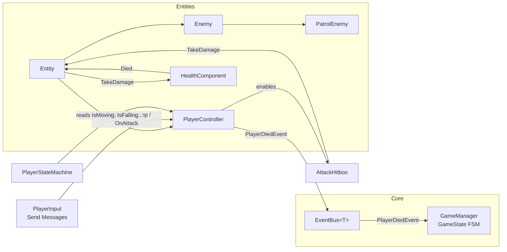

# Architecture

## Overview



## Principles

- **Decoupled cross-system communication.** Systems that should not know about each other (gameplay → game flow, UI, audio) communicate through `EventBus<T>`. Event payloads are structs in `Core/GameBus.cs`.
- **Direct references within a system.** Components on the same GameObject (e.g. `Entity` ↔ `HealthComponent`) use direct references and C# events.
- **Inheritance for identity, composition for capabilities.** `Entity` subclasses define *what* something is; components such as `HealthComponent` define *what it can do* (see [ADR 0002](Decisions/0002-entity-hierarchy.md)).
- **Explicit state machines.** Game flow (`GameManager`) and player state (`PlayerStateMachine`) use enum FSMs with `OnEnter` / `OnExit` hooks. State changes are never triggered from inside `OnEnter`.

## Project layout

| Path | Contents |
|---|---|
| `Assets/_Project/Scripts/Core` | EventBus, event definitions, GameManager |
| `Assets/_Project/Scripts/Components` | Reusable capability components |
| `Assets/_Project/Scripts/Entities` | Entity hierarchy: Player, Enemies |
| `Assets/_Project/Scripts/Systems` | Gameplay systems (combat hitboxes, …) |
| `Assets/_Project/Tests/EditMode` | NUnit EditMode tests |
| `Docs/` | This documentation |

## Assemblies

| Assembly | Location | References |
|---|---|---|
| `Emberway` | `Assets/_Project/Scripts` | `Unity.InputSystem` |
| `Emberway.Tests.EditMode` | `Assets/_Project/Tests/EditMode` | `Emberway`, Unity Test Runner, NUnit |

New runtime folders under `Scripts/` are included automatically. Code using a new package (e.g. Cinemachine) requires adding that package's assembly to `Emberway.asmdef`.

## Conventions

- Private serialized fields: `[SerializeField] private T _camelCase`.
- Tags in use: `Player`, `Enemy`. Layers: `Ground` (ground check).
- Animator parameters: `Speed` (float), `IsGrounded` (bool), `Attack` (trigger).
- Input callbacks are discovered by name (`On<ActionName>(InputValue)`), so renaming an action or method breaks input silently.
- Commits follow Conventional Commits (`feat:`, `fix:`, `docs:`, `test:`).

## Testing

Run via **Window → General → Test Runner → EditMode**. Headless runs require Unity Hub to be running and signed in (license):

```
Unity.exe -batchmode -projectPath . -runTests -testPlatform EditMode -testResults results.xml
```

Components added in EditMode do not receive `Awake()`. Components that need initialization expose a public initializer (e.g. `HealthComponent.ResetHealth()`).
