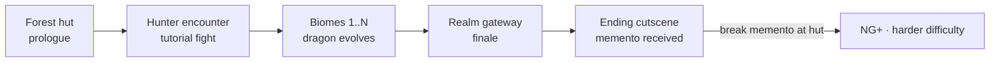

# Story & Game Structure

*Draft. Source: author's story notes. Details will be refined per phase.*

## Premise
A teenage girl lives in a hut in the forest. Investigating a noise, she finds two hunters trying to capture a red baby dragon. She rescues it and escorts it across several biomes to the gateway between the mortal realm and the dragon realm, where its parents reclaim it.

## Structure

## Core pillars

| Pillar | Gameplay expression |
|---|---|
| Bond with the dragon | Companion follows the player; its growth is the progression system |
| Journey through biomes | Interconnected, ability-gated world (metroidvania) |
| Precise combat | Deflect/parry-centred melee, hunters and creatures as enemies |
| Emotional payoff | Parents' farewell and memento in the final cutscene |

## Characters

| Character | Role |
|---|---|
| Mira | Player character. Teenage girl; neutral, helpful, confident. White bob with teal tips, yellow open-front robe-jacket over charcoal undershirt, red-brown sash. Unarmed at the start; sword, bow and staff introduced later |
| Baby dragon (red) | Companion; evolves over the game and grants abilities |
| Hunters (×2) | Prologue antagonists / first enemies; recurring threat (TBD) |
| Dragon parents | Appear at the gateway in the finale |

## Progression via dragon evolution

| Ability (draft) | Effect | World use |
|---|---|---|
| Fireball | Ranged attack | Burn obstacles (gate) |
| Candle light | Light radius in dark biome | Access to the dark biome |
| Attack boost | Increased damage | — |
| Defence boost | Reduced damage taken | — |

Abilities unlock at evolution stages, typically after a biome boss. The skill tree (Phase 6) builds on these.

## New Game+
After the ending, the memento is stored in the starting hut. Breaking it starts NG+ at a higher difficulty. This requires a persistent cross-save flag and difficulty scaling (Phase 5 save system, Phase 10 polish).

## Impact on the roadmap
- **Phase 2/4:** Hunters are the first enemy archetype.
- **Phase 4 (new):** dragon companion follow AI.
- **Phase 5:** prologue hut + forest as the first area. Save data must support NG+.
- **Phase 6:** evolution stages drive ability unlocks.
- **Phase 9:** prologue and ending cutscenes.

## Open questions
- Weapon progression for Mira (sword, bow, staff): when and how each is acquired
- Number and themes of biomes (forest, dark biome, …)
- Do the hunters return later (e.g. as a boss)?
- What the memento is, and what NG+ changes beyond difficulty
