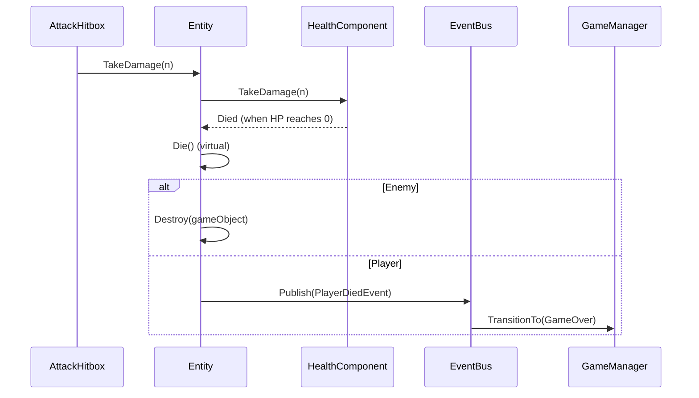

# Entities & Health

`Scripts/Entities/Entity.cs`, `Scripts/Components/HealthComponent.cs`

## Hierarchy

```
Entity (abstract)            TakeDamage, Die (virtual), IsDead
├── PlayerController         Die → publishes PlayerDiedEvent (not destroyed)
└── Enemy (abstract)         Die → destroys GameObject; UpdateBehavior (abstract)
    └── PatrolEnemy
```

## HealthComponent

| Member | Description |
|---|---|
| `MaxHealth`, `CurrentHealth`, `IsDead` | State |
| `TakeDamage(int)` | Reduces health, clamped at 0. Ignored when dead or when amount ≤ 0. |
| `Heal(int)` | Increases health, clamped at max. Ignored when dead or when amount ≤ 0. |
| `ResetHealth()` | Restores max health. Called in `Awake`; use for respawn and tests. |
| `event Action Died` | Raised once, on the lethal hit. |

The component has no knowledge of what owns it. It reports death and does not handle it.

## Death flow



## Extending
- New entity type: derive from `Entity` (or `Enemy`), add a `HealthComponent`, override `Die()` as needed.
- Overrides of `Awake` / `OnDestroy` must call `base.Awake()` / `base.OnDestroy()`. The death subscription lives there.
