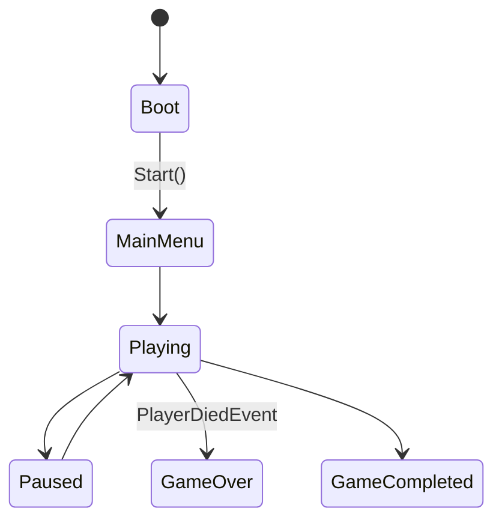

# Game Manager

`Assets/_Project/Scripts/Core/GameManager.cs`

## Purpose
Owns top-level game flow as a finite state machine. Persistent singleton (`GameManager.Instance`, `DontDestroyOnLoad`).

## States

| State | On enter |
|---|---|
| Boot | Reserved for loading settings and save data |
| MainMenu | — |
| Playing | `Time.timeScale = 1` |
| Paused | `Time.timeScale = 0` |
| GameOver | Reserved for game-over UI and respawn (Phase 5) |
| GameCompleted | Publishes `GameCompletedEvent` |

## Rules
- `TransitionTo(state)` runs `OnExit(old)`, then sets the state, then `OnEnter(new)`. Transitions to the current state are ignored.
- `OnEnter` never calls `TransitionTo`. Follow-up transitions are issued by the caller (see `Start()`).
- The manager reacts to gameplay events. It does not re-publish them.

## Setup
One `GameManager` GameObject in the first loaded scene. Duplicates in later scenes destroy themselves.
